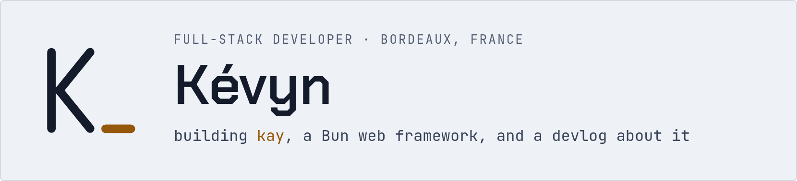

<picture>
  <source media="(prefers-color-scheme: dark)" srcset="assets/banner-dark.png">
  
</picture>

I've been coding since middle school, the last four years for a living: large Nuxt and Symfony projects at work, Bun and TypeScript for everything else. Away from the web, I love Godot and build Minecraft mods and tools.

## kay

[kay](https://kayjs.kaynooo.fr) is my Bun web framework, because the world clearly needed one more. A `.kay` file is one component, TypeScript fences then a pug-like template. Pages render to plain HTML, only the islands ship JavaScript, and everything is typed down to the template line. It ships its docs as an `llms.txt` and checks that catch what coding agents get wrong. It is still experimental and breaks between minors.

- [kayjs](https://github.com/Kayno0o/kayjs): the framework
- [kayjs-auth](https://github.com/Kayno0o/kayjs-auth): sign-in with OAuth, passwords, magic links, two-factor and passkeys
- [kayjs-ui](https://github.com/Kayno0o/kayjs-ui): components styled by one theme: buttons, dialogs, tables, forms, charts
- [kayjs-mail](https://github.com/Kayno0o/kayjs-mail): mails written as `.kay` components, sent through a queue

## devlog

[log.kaynooo.fr](https://log.kaynooo.fr) is where I write about what I build: how it works, what it costs, and the benchmarks behind it.

- [kayjs: fast to run, easy to write](https://log.kaynooo.fr/posts/introducing-kay)
- [What a web framework costs a coding agent](https://log.kaynooo.fr/posts/coding-agent-bench)
- [One page in Next.js, Nuxt, Astro, Svelte and Solid](https://log.kaynooo.fr/posts/five-frameworks)
- [A SvelteKit site, moved to kay](https://log.kaynooo.fr/posts/ported-from-sveltekit)

The rest, and an [RSS feed](https://log.kaynooo.fr/rss.xml), on the blog.

## Also

- [pg-orm](https://github.com/Kayno0o/pg-orm): a typed Postgres ORM on `bun:sql`
- [eslint](https://github.com/Kayno0o/eslint): my ESLint ruleset, because code should breathe

## What I work with

          

Questions and issues on kay are welcome on [its repository](https://github.com/Kayno0o/kayjs/issues), or write to me at contact@kaynooo.fr.
