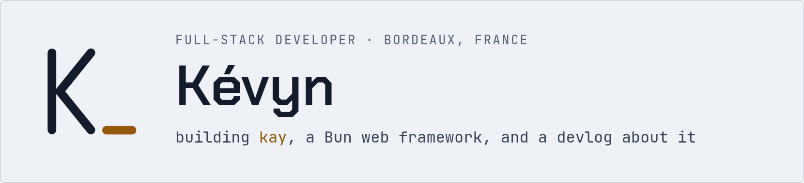

<picture>
  <source media="(prefers-color-scheme: dark)" srcset="assets/banner-dark.png">
  
</picture>

I've been coding since middle school, and for a living these last four years: large Nuxt and Symfony projects at work, Bun and TypeScript for everything else. Away from the web, I tinker with Godot and build Minecraft mods and tools.

## kay

[kay](https://kayjs.kaynooo.fr) is my Bun web framework, because the world clearly needed one more (/s). A `.kay` file is one component: TypeScript fences, then a pug-like template. Pages render to plain HTML, only the islands ship JavaScript, and types reach down to the template line. Its docs ship as an `llms.txt`, with checks that catch what coding agents get wrong. It is still experimental and breaks between minors.

[One repository](https://github.com/Kayno0o/kayjs) holds the framework and its libraries:

- [auth](https://github.com/Kayno0o/kayjs/tree/main/packages/auth): OAuth, passwords, two-factor, magic links and bearer tokens on kay sessions
- [ui](https://github.com/Kayno0o/kayjs/tree/main/packages/ui): dialogs, tables, toasts, forms and more, as `.kay` sources the app compiles as its own
- [mail](https://github.com/Kayno0o/kayjs/tree/main/packages/mail): mails written as `.kay` components, SMTP from typed env variables, queued sending
- [cms](https://github.com/Kayno0o/kayjs/tree/main/packages/cms): content edited on the page it renders, plus collection screens
- [ai](https://github.com/Kayno0o/kayjs/tree/main/packages/ai): LLM calls with no SDK, Anthropic or OpenAI-compatible, replies streamed into the page

## cli

[cli](https://github.com/Kayno0o/cli) is the toolbox my coding agents work with: small Bun CLIs, each on npm as `@kaynooo/cli-<name>`. `check` runs a repo's lint, types and tests and prints only what failed. `db` runs read-only SQL without ever showing the credentials, `ev` edits .env files with the values masked, and `guard` holds every Bash call an agent makes to a set of safety rules.

## devlog

[log.kaynooo.fr](https://log.kaynooo.fr) is where I write about what I build: how it works, what it costs, and the benchmarks behind it.

- [kayjs: fast to run, easy to write](https://log.kaynooo.fr/posts/introducing-kay)
- [What a web framework costs a coding agent](https://log.kaynooo.fr/posts/coding-agent-bench)
- [One page in Next.js, Nuxt, Astro, Svelte and Solid](https://log.kaynooo.fr/posts/five-frameworks)
- [A SvelteKit site, moved to kay](https://log.kaynooo.fr/posts/ported-from-sveltekit)

Everything else, and an [RSS feed](https://log.kaynooo.fr/rss.xml), is on the blog.

## Also

- [pg-orm](https://github.com/Kayno0o/pg-orm): a typed Postgres ORM on `bun:sql`
- [eslint](https://github.com/Kayno0o/eslint): my ESLint ruleset, because code should breathe

## What I work with

          

Questions and issues about kay go on [its repository](https://github.com/Kayno0o/kayjs/issues); for anything else, write to me at contact@kaynooo.fr.
